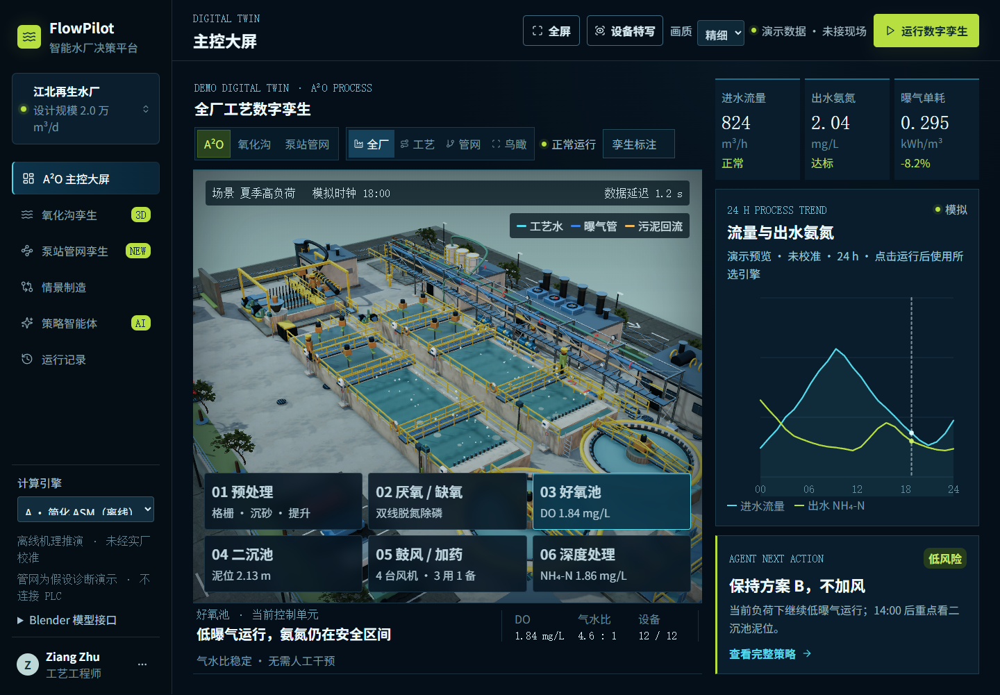
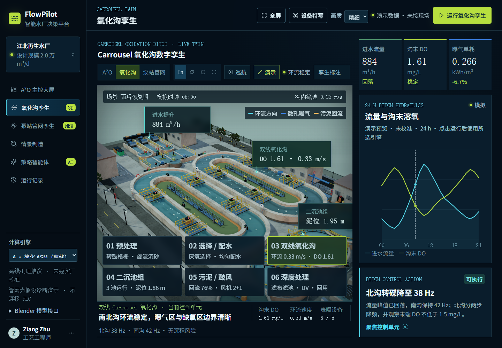
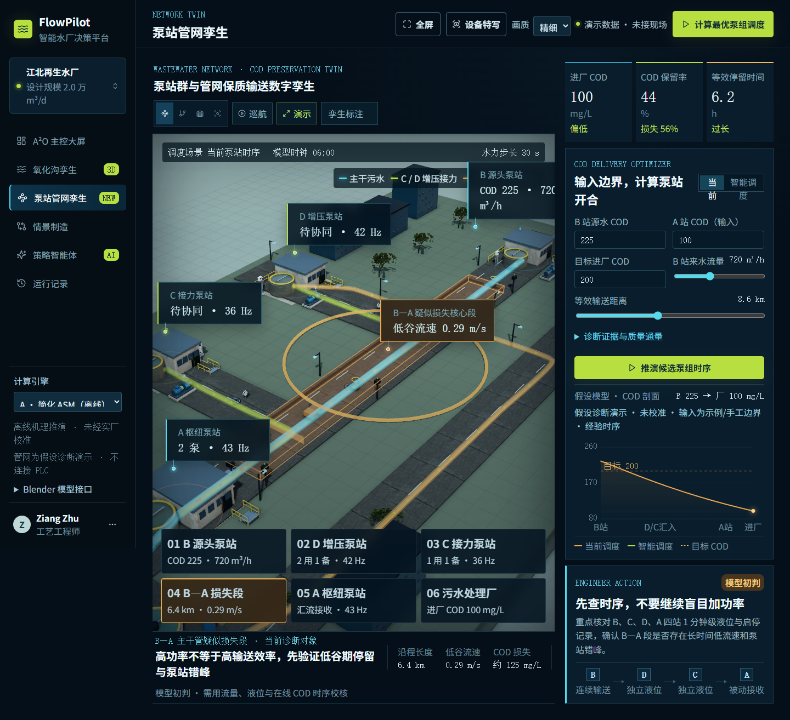

# FlowPilot · 污水处理数字孪生演示平台

本地运行的三维工艺展示与决策演示：A²O全厂、Carrousel氧化沟、泵站管网。支持场景切换、情景输入、简化ASM方案比较、全屏展示及Blender细节模型。

## 下载与启动

**只想体验：打开本仓库右侧 Releases，下载 `FlowPilot-Windows-x64-v1.0.0.zip`，完整解压，双击 `start_flowpilot.bat`。**

Windows版自带精简Python运行时，无需安装Python、Blender、SUMO或任何pip包。需要Windows 10/11 x64及支持WebGL的Chrome或Edge。浏览器自动打开本地地址；使用期间保持启动窗口打开，关闭窗口即停止服务。首次三维加载需稍候。

**查看/修改源码：Code → Download ZIP，解压后安装Python 3.10或以上。**

```bash
python server.py --open
```

Windows也可双击 `start_flowpilot.bat`；macOS/Linux运行 `sh start_flowpilot.sh`（这两个系统尚未实机验收）。无需执行pip install。必须通过本地服务打开，不能直接双击index.html。源码版不附带Python运行时。

默认仅监听127.0.0.1:8787；端口被占用时自动尝试后续端口，以启动窗口显示的地址为准。也可指定 `python server.py --port 8890 --open`。运行不依赖外网CDN。此服务用于本地演示，不是公网生产服务器。

## 三个场景

| 场景 | 展示内容 | 主要代码 |
| --- | --- | --- |
| A²O全厂 | 工艺分区、曝气、回流、方案比较 | app.js / initPlant3d |
| Carrousel氧化沟 | 双线沟体、转碟、DO与设备建议 | app.js / initOxidation3d |
| 泵站管网 | 泵站、管路、COD与输送时序诊断 | network.js / initNetwork3d |





## 实现与目录

浏览器端HTML/CSS/JavaScript与Three.js负责交互、三维建模和可视化。Python标准库HTTP服务提供 `/api/status` 和 `/api/run`；`engines/asm.py` 完成简化机理计算。管网诊断与动画主要在浏览器端运行。

- `server.py`：服务、参数归一化、可选SUMO调用适配器。
- `engines/asm.py`：简化ASM计算，RK4积分。
- `assets/`：已本地化的第三方库、贴图、HDRI和植被图。
- `models/blender/manifest.json`：三个场景的细节GLB加载清单。
- `models/blender/refined/`：运行GLB、可编辑Blender工程、预览。
- `blender/`：建模、烘焙与导出脚本，详见 `blender/WORKFLOW.md`。
- `tests/`：机理响应与本地服务测试。
- `DATA_CONTRACT.json`：数据字段与演示边界。
- `docs/`：使用、架构与发布说明。

## 模型与功能边界

默认使用独立简化ASM：两个完全混合区、固定活性生物量、Monod碳氧化/反硝化/硝化、氧转移与内回流。不是完整ASM1/ASM2d，不模拟生物除磷、污泥沉降、水力流场、碱度或生物量长期变化。尚未完成目标水厂校准；能耗系数为演示假设。

策略界面比较基线与规则候选，不代表已部署强化学习自主搜索或大语言模型。管网为带假设的COD诊断演示；浓度变化不能直接等同污染物质量变化。部分遥测及初始历史记录属于展示数据，点击采用不向PLC发令，记录不构成现场持久化审计。

SUMO适配器为可选高级接口，需使用者自行提供合法SUMO/DTT许可、Python接口及适配模型。公开包不包含SUMO安装程序、许可证或原供应商示例工程。配置方法见 `models/sumo/README.md`。普通离线演示不受影响。

## 开发验证

```bash
python -m unittest discover -s tests -v
```

Windows便携版可使用 `runtime\python.exe -m unittest discover -s tests -v`。本次发布验收范围见 `docs/VALIDATION.txt`。

## 使用与第三方许可

本次提供可查看源代码的演示发布，尚未为项目自有代码指定MIT/Apache等通用开源许可；商业使用、改作和再分发权限请联系项目权利人确认。第三方组件继续适用各自许可，见 `THIRD_PARTY_NOTICES.txt`。不以公开代码替代学校或合作方成果授权。

## 重新制作Windows包

运行 `python tools/build_windows.py`，构建程序下载并校验固定版本官方Python嵌入包，生成dist目录中的Windows ZIP。需要构建电脑联网；使用者启动不需要下载依赖。新版本发布前请更新脚本版本号并重新验收。
